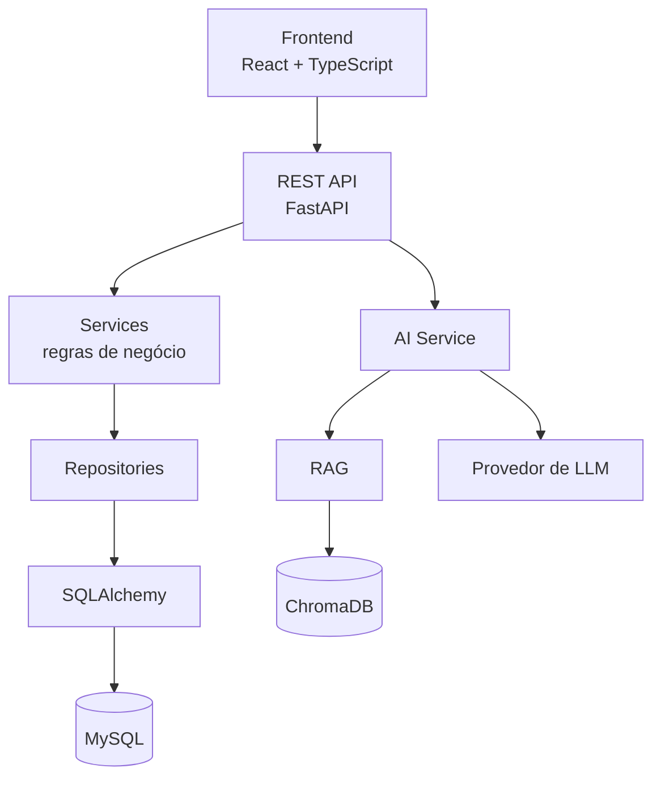

# AI Help Desk

**Sistema inteligente de gerenciamento e automação de suporte de TI.**

Plataforma SaaS multiempresa que une a operação completa de um Help Desk (chamados, SLA, histórico, base de conhecimento e indicadores) a uma camada de Inteligência Artificial integrada a todo o ciclo de atendimento: abertura, classificação, atendimento, consulta à base de conhecimento, resolução e análise.

> **A IA sugere. O backend autoriza.** A inteligência artificial nunca controla permissões nem envia respostas sozinha: toda ação passa pelas regras de negócio e de segurança do sistema.

## Destaques

- **Multiempresa de verdade:** isolamento por empresa garantido na camada de dados e coberto por testes.
- **IA com guarda-corpos:** RAG restrito à empresa, respostas com fontes, saídas do LLM validadas e nenhuma ação automática sem revisão humana.
- **Regras de negócio no backend:** fluxo de status, SLA e permissões validados no servidor, não na interface.
- **Interface de produto B2B:** design system próprio, responsiva (sidebar vira drawer no mobile) e acessível (teclado, foco visível, leitores de tela).
- **Pronto para rodar:** um `docker compose up` sobe frontend, API, MySQL e banco vetorial, com dados de demonstração.

## Início rápido

```bash
git clone https://github.com/Hendel2/AI-Help-desk.git
cd AI-Help-desk
cp .env.example .env          # defina JWT_SECRET, MYSQL_ROOT_PASSWORD e MYSQL_PASSWORD
docker compose up -d --build
docker compose exec backend python -m app.cli.seed_demo
```

Acesse http://localhost:5173 e entre com `admin@demo.helpdesk` / `demo12345` (outros perfis em [Dados de demonstração](#dados-de-demonstração)).

### Roteiro sugerido para conhecer o sistema

1. Entre como **usuário** e abra um chamado — a IA sugere categoria e prioridade.
2. Entre como **técnico**, assuma o chamado e use o **AI Copilot** para resumir e sugerir uma solução.
3. Responda, resolva e veja o **SLA** e o **histórico** sendo atualizados.
4. Volte como usuário, feche e avalie o atendimento.
5. Entre como **administrador** e acompanhe os indicadores no dashboard.
6. Teste o **Assistente de TI**: faça uma pergunta, veja a resposta com fontes e peça para abrir um chamado.

## Sumário

- [Problema resolvido](#problema-resolvido)
- [Funcionalidades](#funcionalidades)
- [Arquitetura](#arquitetura)
- [Stack](#stack)
- [Estrutura de pastas](#estrutura-de-pastas)
- [Como executar](#como-executar)
- [Dados de demonstração](#dados-de-demonstração)
- [Variáveis de ambiente](#variáveis-de-ambiente)
- [Testes](#testes)
- [API](#api)
- [IA e RAG](#ia-e-rag)
- [Segurança](#segurança)
- [Licença](#licença)

## Problema resolvido

Equipes de TI recebem um grande volume de solicitações repetitivas, perdem prazos por falta de visibilidade e dependem do conhecimento individual dos técnicos. O AI Help Desk resolve isso com:

- **Organização:** todo atendimento vira um chamado rastreável, com número amigável (`HD-000102`), responsável, prioridade, histórico e SLA.
- **Prazos visíveis:** cada chamado mostra em tempo real se está no prazo, próximo do vencimento ou vencido.
- **Autoatendimento:** o Assistente de TI resolve problemas simples com base na documentação interna da empresa e abre chamados quando não consegue.
- **Produtividade do técnico:** o AI Copilot resume chamados, sugere soluções e redige respostas para revisão.
- **Gestão:** dashboards e insights mostram volume, gargalos, cumprimento de SLA e satisfação.

## Funcionalidades

### Chamados
- Abertura em etapas, com sugestão de categoria e prioridade pela IA.
- Numeração sequencial por empresa (`HD-000001`).
- Fluxo de status validado no backend: `Aberto → Em triagem → Atribuído → Em andamento → Aguardando usuário → Resolvido → Fechado`, com cancelamento e reabertura.
- Atribuição a técnicos; quem inicia o atendimento assume o chamado.
- Comentários públicos e **internos** (visíveis apenas para a equipe).
- Anexos com validação de tamanho, extensão e tipo.
- Histórico completo de alterações e avaliação do atendimento (1 a 5).
- Listagem com busca, filtros e paginação.

### SLA
- Políticas por categoria e por prioridade (ex.: Crítica — resposta em 15 min, resolução em 2 h).
- Prazos de resposta e de resolução calculados automaticamente.
- Estados **No prazo**, **Próximo do vencimento** e **Vencido**, recalculados ao mudar categoria ou prioridade.

### Inteligência Artificial
- **Assistente de TI:** chatbot que responde com base na base de conhecimento, cita as fontes e escala para um chamado quando necessário (`source=CHATBOT`).
- **Classificação automática** de intenção, categoria e prioridade, sempre validada pelo backend.
- **AI Copilot** para técnicos: resumir chamado, sugerir solução, encontrar artigos, gerar resposta e analisar histórico. A resposta é editável e nunca é enviada automaticamente.
- **AI Insights** no dashboard administrativo.
- Registro de todas as ações de IA e feedback dos usuários (👍/👎).

### Base de conhecimento
- Artigos por categoria, artigos populares e recentes.
- Upload de PDF, DOCX, TXT e MD com extração, chunking, embeddings e indexação vetorial.
- Avaliação de artigos ("Este artigo ajudou?").

### Gestão e administração
- Dashboards específicos para usuário, técnico e administrador.
- Gestão de usuários, departamentos, categorias, políticas de SLA e configurações de IA.
- Notificações de novos chamados, atribuições, comentários, resoluções e alertas de SLA.
- Trilha de auditoria de ações sensíveis.

### Perfis de acesso

| Perfil | Pode |
|--------|------|
| **Usuário** | Abrir e acompanhar os próprios chamados, comentar, anexar arquivos, avaliar o atendimento, usar o Assistente de TI e consultar a base de conhecimento |
| **Técnico** | Ver os chamados da empresa, assumir, alterar status e prioridade, comentar internamente, resolver e usar o AI Copilot |
| **Administrador** | Tudo do técnico, além de gerenciar usuários, categorias, SLA, base de conhecimento, configurações e auditoria |

## Arquitetura



O backend segue uma arquitetura em camadas — **Route → Schema → Service → Repository → SQLAlchemy** — e as regras de negócio nunca ficam nas rotas. A camada de IA é isolada atrás de interfaces, o que permite trocar o provedor de LLM ou o banco vetorial sem reescrever a aplicação.

**Multiempresa:** toda entidade de dados empresariais possui `company_id`, e os repositórios exigem esse filtro em todas as consultas. Um usuário nunca acessa dados de outra empresa; recursos de outra empresa respondem `404`, sem revelar sua existência.

No frontend, os dados seguem o fluxo **Componente → Hook → TanStack Query → Service → API**, sem chamadas HTTP espalhadas pelos componentes.

### Serviços do Docker Compose

| Serviço | Imagem | Porta (host → container) | Função |
|---------|--------|--------------------------|--------|
| `frontend` | `./frontend` | `5173 → 5173` | Interface web (Vite) |
| `backend` | `./backend` | `8000 → 8000` | API FastAPI; aplica as migrations ao iniciar |
| `mysql` | `mysql:8.4` | `127.0.0.1:3307 → 3306` | Banco relacional (utf8mb4, UTC) |
| `vector-db` | `chromadb/chroma` | `127.0.0.1:8001 → 8000` | Banco vetorial do RAG |

## Stack

| Camada | Tecnologias |
|--------|-------------|
| Backend | Python, FastAPI, SQLAlchemy 2, Alembic, Pydantic, JWT, Argon2 |
| Banco de dados | MySQL 8.4 |
| Frontend | React 19, TypeScript, Vite, Tailwind CSS 4, React Router, TanStack Query, React Hook Form, Zod, Lucide |
| IA e RAG | Camada de abstração de LLM, ChromaDB |
| Qualidade | Pytest, Ruff, Vitest, Testing Library, ESLint (com regras de acessibilidade) |
| Infraestrutura | Docker, Docker Compose |

## Estrutura de pastas

```
AI-help-desk/
├── backend/
│   ├── app/
│   │   ├── api/v1/          # rotas por recurso (auth, tickets, chat, knowledge, ai, dashboard...)
│   │   ├── core/            # configuração, banco, segurança, logs, erros
│   │   ├── models/          # modelos SQLAlchemy
│   │   ├── schemas/         # schemas Pydantic
│   │   ├── repositories/    # acesso a dados com escopo de empresa
│   │   ├── services/        # regras de negócio, SLA e camada de IA
│   │   └── cli/             # comandos utilitários (seed de demonstração)
│   ├── alembic/             # migrations
│   └── tests/
├── frontend/
│   └── src/
│       ├── components/      # biblioteca de componentes (ui/ = primitivos)
│       ├── features/        # módulos por domínio (auth, tickets, chat...)
│       ├── layouts/         # layout principal, sidebar e topbar
│       ├── pages/           # telas
│       ├── services/        # cliente HTTP e TanStack Query
│       ├── hooks/
│       └── utils/
├── docs/
├── docker-compose.yml
└── .env.example
```

## Como executar

### Opção 1: Docker Compose (recomendado)

```bash
cp .env.example .env
# edite o .env e defina JWT_SECRET, MYSQL_ROOT_PASSWORD e MYSQL_PASSWORD
docker compose up -d --build
```

| Endereço | Serviço |
|----------|---------|
| http://localhost:5173 | Aplicação web |
| http://localhost:8000/api/docs | Documentação interativa da API (Swagger) |
| http://localhost:8000/api/v1/health | Health check |

Para gerar um `JWT_SECRET` seguro:

```bash
python -c "import secrets; print(secrets.token_urlsafe(48))"
```

### Opção 2: localmente, sem Docker

Requisitos: Python 3.12+, Node.js 20.19+ e um MySQL/MariaDB (ou SQLite para testes rápidos).

**Backend**

```bash
cd backend
python -m venv .venv
source .venv/bin/activate        # Windows: .venv\Scripts\activatectivate
pip install -r requirements-dev.txt
alembic upgrade head
uvicorn app.main:app --reload
```

**Frontend**

```bash
cd frontend
npm install
npm run dev
```

O servidor do Vite encaminha `/api` para o backend (`VITE_PROXY_TARGET`, padrão `http://localhost:8000`).

## Dados de demonstração

Para popular o banco com uma empresa de exemplo (usuários, categorias, políticas de SLA e chamados dos últimos 30 dias):

```bash
# com Docker
docker compose exec backend python -m app.cli.seed_demo

# localmente (com o ambiente virtual ativado)
cd backend
python -m app.cli.seed_demo
```

| E-mail | Perfil | Senha |
|--------|--------|-------|
| `admin@demo.helpdesk` | Administrador | `demo12345` |
| `tecnico@demo.helpdesk` | Técnico | `demo12345` |
| `usuario@demo.helpdesk` | Usuário | `demo12345` |

O comando é idempotente e não roda em produção.

## Variáveis de ambiente

| Variável | Usada por | Descrição |
|----------|-----------|-----------|
| `ENVIRONMENT` | backend | `development`, `test` ou `production` |
| `DATABASE_URL` | backend | URL do banco (sobrescrita automaticamente no Docker) |
| `JWT_SECRET` | backend | Segredo dos tokens; obrigatório e com 32+ caracteres em produção |
| `CORS_ORIGINS` | backend | Origens permitidas, separadas por vírgula |
| `LOG_LEVEL` | backend | Nível dos logs estruturados (JSON) |
| `AI_PROVIDER` / `AI_API_KEY` / `AI_MODEL` | backend | Provedor e modelo de LLM |
| `VECTOR_DB_URL` | backend | Endereço do ChromaDB |
| `UPLOAD_DIR` / `MAX_UPLOAD_SIZE_MB` | backend | Armazenamento e limite de anexos |
| `MYSQL_ROOT_PASSWORD` / `MYSQL_PASSWORD` | Docker | Senhas do MySQL |
| `MYSQL_DATABASE` / `MYSQL_USER` / `MYSQL_HOST_PORT` | Docker | Banco, usuário e porta no host |
| `VITE_API_URL` / `VITE_PROXY_TARGET` | frontend | Base da API e destino do proxy em desenvolvimento |

Nenhum segredo é enviado ao frontend. O arquivo `.env` nunca é versionado; use o `.env.example` como referência.

## Testes

```bash
# backend (com o ambiente virtual ativado)
cd backend
pytest
ruff check .

# frontend
cd frontend
npm test
npm run lint
npm run typecheck
```

A suíte cobre os cenários críticos da plataforma, entre eles:

- usuário de uma empresa não acessa chamados de outra;
- usuário comum não executa ações de técnico ou administrador;
- transições de status inválidas são recusadas;
- SLA calculado corretamente (no prazo, alerta e vencido);
- comentários internos ocultos do solicitante;
- chamado criado pelo chatbot recebe `source=CHATBOT`;
- tokens adulterados, expirados ou de outra empresa são rejeitados.

## API

Documentação interativa em `/api/docs`. Todas as rotas usam o prefixo `/api/v1`.

| Recurso | Endpoints principais |
|---------|----------------------|
| Autenticação | `POST /auth/register`, `POST /auth/login`, `POST /auth/refresh`, `GET /auth/me` |
| Chamados | `GET/POST /tickets`, `GET/PUT /tickets/{id}`, `POST /tickets/{id}/assign`, `/status`, `/resolve`, `/close`, `GET/POST /tickets/{id}/comments`, `GET /tickets/{id}/history` |
| Categorias | `GET /categories` |
| Usuários | `GET/POST /users`, `GET/PUT/DELETE /users/{id}` |
| Chat | `GET/POST /chat/conversations`, `POST /chat/conversations/{id}/messages` |
| Base de conhecimento | `GET/POST /knowledge`, `GET/PUT/DELETE /knowledge/{id}`, `POST /knowledge/upload`, `POST /knowledge/{id}/index` |
| IA | `POST /ai/classify`, `/ai/summarize`, `/ai/suggest-solution`, `/ai/generate-response` |
| Dashboard | `GET /dashboard/metrics`, `/dashboard/tickets`, `/dashboard/sla`, `/dashboard/ai` |
| Sistema | `GET /health` |

Erros seguem um formato único:

```json
{ "error": { "code": "TICKET_NOT_FOUND", "message": "Chamado não encontrado.", "details": null } }
```

Listagens são paginadas: `{ "items": [], "total": 0, "page": 1, "page_size": 20, "pages": 0 }`.

## IA e RAG

```
Pergunta → Embedding → Busca vetorial (filtrada por empresa) → Trechos relevantes → LLM → Resposta validada com fontes
```

- O RAG consulta apenas a base de conhecimento da empresa do usuário.
- As respostas do assistente indicam as fontes utilizadas e não inventam procedimentos internos.
- Toda saída estruturada do LLM (ex.: classificação) é validada pelo backend antes de ser usada.
- A IA nunca solicita senhas ou tokens, não altera permissões e não executa ações críticas sem validação.
- Ações de IA são registradas com modelo, tokens, latência e resultado.

## Segurança

- Senhas com Argon2id; tokens JWT de acesso (curto) e renovação, com verificação de tipo.
- Autorização por perfil e isolamento multiempresa validados no backend.
- Mensagens de login genéricas, sem enumeração de contas.
- Validação de entrada com Pydantic, sem eco de dados sensíveis nos erros.
- Logs estruturados com request id, sem senhas, tokens ou chaves.
- Auditoria de login, criação de usuários e alterações em chamados.
- Documentação da API desabilitada em produção.

## Autor

Desenvolvido por **Hendel** — [github.com/Hendel2](https://github.com/Hendel2).

## Licença

Distribuído sob a licença MIT.
