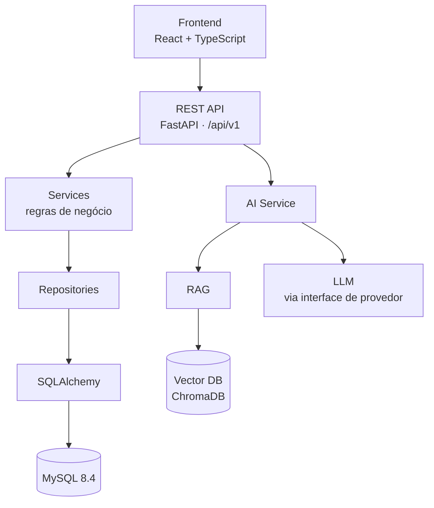
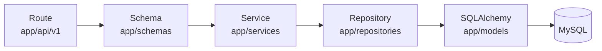
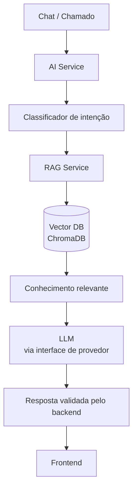

# AI Help Desk

**Sistema inteligente de gerenciamento e automação de suporte de TI.**

Plataforma web multiempresa (SaaS) de Help Desk de TI com uma camada de Inteligência Artificial: chatbot de suporte, RAG sobre a base de conhecimento e AI Copilot para técnicos, integrados ao ciclo de atendimento.

> [!IMPORTANT]
> **Status: em desenvolvimento inicial.** A etapa em andamento é a **Fundação (etapas 01–03)**: estrutura do monorepo, modelos de dados com a migration inicial, backend base e scaffold do frontend.
> Ainda **não** existem autenticação, gestão de chamados, telas de negócio nem recursos de IA (as tabelas já existem no banco, mas sem endpoints). Tudo o que aparece como *planejado* neste README ainda não está implementado.

## Sumário

- [Descrição](#descrição)
- [Problema resolvido](#problema-resolvido)
- [Funcionalidades](#funcionalidades)
- [Arquitetura](#arquitetura)
- [Stack](#stack)
- [Estrutura de pastas](#estrutura-de-pastas)
- [Como executar](#como-executar)
- [Variáveis de ambiente](#variáveis-de-ambiente)
- [Testes](#testes)
- [API](#api)
- [IA e RAG](#ia-e-rag)
- [Screenshots](#screenshots)
- [Roadmap](#roadmap)
- [Documentação](#documentação)
- [Licença](#licença)

## Descrição

O AI Help Desk combina as funcionalidades de um Help Desk tradicional (chamados, SLA, histórico, comentários, anexos, notificações e base de conhecimento) com recursos de IA que ajudam na triagem, respondem dúvidas recorrentes e apoiam os técnicos no atendimento.

A IA **não** substitui a estrutura do Help Desk. Ela é uma camada de inteligência sobre um sistema que continua responsável pela operação, pelas regras de negócio e pela segurança:

> **A IA sugere. O backend autoriza.**

O projeto é desenvolvido como portfólio com padrão profissional e foi pensado para poder evoluir para um produto SaaS. A especificação completa está em [docs/especificacao.md](docs/especificacao.md).

## Problema resolvido

Equipes de suporte de TI costumam lidar com:

- solicitações chegando por e-mail, chat ou corredor, sem registro, prioridade ou responsável definido;
- prazos de atendimento (SLA) acompanhados manualmente e descumpridos sem aviso;
- as mesmas dúvidas simples (senha, VPN, impressora, e-mail) consumindo o tempo dos técnicos;
- conhecimento interno espalhado e difícil de encontrar;
- falta de histórico e de indicadores para avaliar o desempenho do suporte.

A proposta do AI Help Desk é centralizar o atendimento em um fluxo rastreável (abertura → triagem → atendimento → resolução → avaliação), resolver dúvidas simples com um assistente que responde com base na documentação interna da empresa, citando as fontes, e encaminhar para atendimento humano o que exige intervenção. Para os técnicos, um copiloto resume chamados e sugere soluções, sempre sujeitas à revisão humana.

## Funcionalidades

### Disponível hoje: Fundação (etapas 01–03, em andamento)

- Monorepo com `backend/` (FastAPI), `frontend/` (React + Vite) e `docker-compose.yml` com MySQL 8.4 e ChromaDB.
- **Banco de dados:** modelos SQLAlchemy das 19 tabelas da especificação (empresas, perfis, usuários, departamentos, categorias, chamados e seus comentários, anexos, histórico e avaliações, políticas de SLA, notificações, auditoria, conversas, mensagens, base de conhecimento e registros de IA) e migration inicial do Alembic, compatível com MySQL 8.4 (Docker/produção) e SQLite (testes e dev local).
- **Backend base:** configuração por variáveis de ambiente (com validação extra em produção), health check `GET /api/v1/health`, formato padronizado de erros, logs estruturados em JSON com request id (`X-Request-ID`), repositório base com escopo multiempresa obrigatório e documentação OpenAPI (Swagger).
- **Frontend:** scaffold com React 19, TypeScript em modo `strict`, Vite, Tailwind CSS v4 e React Router. Uma página temporária de status consulta o health check da API e valida o fluxo completo de dados; também há uma página 404.
- **Testes:** Pytest no backend (configuração, erros, health check, modelos, migration e repositórios) e Vitest no frontend.
- **Skills do Claude Code:** as 10 skills do projeto em `.claude/skills/`.

### Planejado

| Área | Funcionalidades | Etapa |
|------|-----------------|-------|
| Autenticação e perfis | Login com JWT, refresh token, senhas com Argon2, perfis USER, TECHNICIAN e ADMIN, rotas protegidas | 04 |
| Interface | Design system, layout com sidebar e topbar, dashboards por perfil | 05–07 |
| Chamados | Abertura, listagem com filtros e busca, atribuição, status com transições válidas, prioridade, comentários internos e externos, anexos, avaliação do atendimento | 08 |
| SLA | Políticas de SLA e acompanhamento de prazos | 09 |
| Histórico | Linha do tempo de alterações de cada chamado | 10 |
| Notificações | Avisos de eventos relevantes do chamado | 11 |
| AI Service | Camada de abstração do provedor de LLM e classificação automática de chamados | 12 |
| Chatbot | **Assistente de TI**: identifica a intenção, responde com a base de conhecimento e escala para um chamado quando necessário | 13 |
| Base de conhecimento | Artigos, categorias, busca e upload de PDF, DOCX, TXT e MD | 14 |
| RAG | Indexação em banco vetorial e respostas com fontes | 15 |
| AI Copilot | Resumir chamado, sugerir solução, encontrar artigos, gerar resposta editável e analisar histórico | 16 |
| Administração | Usuários, departamentos, categorias, SLA, configurações e auditoria | 17 |
| Analytics | Métricas, gráficos de SLA e desempenho, insights de IA | 18 |

Transversal a todas as etapas: **isolamento multiempresa**. Toda entidade de dados empresariais tem `company_id` e o repositório base já exige esse filtro em todas as consultas. A partir da autenticação, cada requisição fica limitada à empresa do usuário autenticado, e o acesso a recursos de outra empresa responde `404`, para não revelar sua existência.

## Arquitetura

Visão geral (seção 94 da especificação):



O backend segue uma arquitetura em camadas. As rotas não contêm regras de negócio:



No frontend, o fluxo de dados é **Component → Hook → TanStack Query → Service → API**; componentes nunca chamam `fetch` diretamente.

### Serviços do Docker Compose

| Serviço | Imagem / build | Porta (host → container) | Função |
|---------|----------------|--------------------------|--------|
| `frontend` | `./frontend` | `5173 → 5173` | Servidor de desenvolvimento do Vite com hot reload; encaminha `/api` para o backend |
| `backend` | `./backend` | `8000 → 8000` | API FastAPI; aplica as migrations (`alembic upgrade head`) ao iniciar |
| `mysql` | `mysql:8.4` | `127.0.0.1:3307 → 3306` | Banco relacional (utf8mb4, UTC) |
| `vector-db` | `chromadb/chroma:1.5.9` | `127.0.0.1:8001 → 8000` | Banco vetorial do RAG: provisionado agora, utilizado a partir da etapa 15 |

MySQL e ChromaDB ficam expostos apenas em `localhost`. Os dados persistem nos volumes nomeados `mysql-data`, `chroma-data` e `backend-uploads`.

## Stack

| Camada | Tecnologias |
|--------|-------------|
| Backend | Python 3.12+ (imagem Docker com 3.13), FastAPI, SQLAlchemy 2 (síncrono), Alembic, Pydantic v2, pydantic-settings, PyMySQL, Pytest, Ruff |
| Frontend | React 19, TypeScript, Vite, Tailwind CSS v4, React Router, TanStack Query, React Hook Form, Zod, Lucide React, Vitest, Testing Library, ESLint |
| Banco de dados | MySQL 8.4 (Docker/produção) e SQLite (testes e dev local) |
| IA e RAG | ChromaDB como banco vetorial; provedor de LLM atrás de uma interface (definido na etapa 12) |
| Infraestrutura | Docker e Docker Compose |
| Planejado | JWT e Argon2 (etapa 04) |

## Estrutura de pastas

```text
AI-help-desk/
├── backend/                    # API FastAPI
│   ├── app/
│   │   ├── api/v1/             # rotas versionadas (hoje: health)
│   │   ├── core/               # configuração, banco, logs, middlewares, erros
│   │   ├── models/             # modelos SQLAlchemy
│   │   ├── schemas/            # schemas Pydantic
│   │   ├── repositories/       # acesso a dados (dados empresariais sempre filtrados por company_id)
│   │   ├── services/           # regras de negócio
│   │   └── main.py             # create_app() e app
│   ├── alembic/                # migrations
│   ├── tests/                  # testes Pytest
│   ├── Dockerfile
│   └── docker-entrypoint.sh    # aplica as migrations e inicia o uvicorn
├── frontend/                   # React + Vite
│   ├── src/
│   │   ├── hooks/              # hooks (TanStack Query)
│   │   ├── pages/              # páginas
│   │   ├── routes/             # rotas (React Router)
│   │   ├── services/           # serviços e cliente HTTP (services/api/client.ts)
│   │   ├── test/               # setup e utilitários de teste
│   │   └── types/              # tipos compartilhados
│   └── Dockerfile
├── docs/
│   └── especificacao.md        # especificação completa
├── .claude/skills/             # skills do projeto para o Claude Code
├── docker-compose.yml
├── .env.example                # modelo de configuração (o .env real nunca é versionado)
├── CLAUDE.md                   # convenções e contratos de desenvolvimento
└── README.md
```

## Como executar

### Opção 1: Docker Compose (recomendado)

Pré-requisito: Docker com Docker Compose v2 ou superior (comando `docker compose`).

```bash
cp .env.example .env              # PowerShell: Copy-Item .env.example .env
```

Edite o `.env` e preencha **`JWT_SECRET`**, **`MYSQL_ROOT_PASSWORD`** e **`MYSQL_PASSWORD`**, gerando um valor diferente para cada um:

```bash
python -c "import secrets; print(secrets.token_urlsafe(48))"
```

O compose se recusa a subir enquanto algum desses valores estiver vazio. Depois, suba o ambiente:

```bash
docker compose up --build
```

| Endereço | O que é |
|----------|---------|
| http://localhost:5173 | Frontend |
| http://localhost:8000/api/v1/health | Health check da API |
| http://localhost:8000/api/docs | Documentação interativa (Swagger) |
| http://localhost:8001 | ChromaDB (somente na máquina local) |
| `localhost:3307` | MySQL do Docker (somente na máquina local; 3306 fica livre para o XAMPP) |

Observações:

- O backend só inicia depois que o MySQL passa no health check e aplica as migrations automaticamente.
- O frontend tem hot reload: o código de `frontend/` é montado no container. Depois de alterar dependências (`package.json`), recrie o volume de `node_modules` com `docker compose up --build -V frontend`.
- O código do backend é copiado para a imagem; depois de alterá-lo, rode `docker compose up --build backend`.
- `docker compose down` para os containers e mantém os dados. `docker compose down -v` **apaga** os volumes (banco, vetores e uploads).

### Opção 2: localmente, sem Docker

Pré-requisitos: Python 3.12+ e Node.js 22 (22.22.2+) ou 24 (24.15+), conforme o campo `engines` de `frontend/package.json`.

Copie o `.env.example` para `.env` na raiz (opcional: sem ele, o backend usa os valores padrão de desenvolvimento).

**Backend**: sem MySQL, o backend usa **SQLite** por padrão (`DATABASE_URL=sqlite:///./helpdesk_dev.db`, arquivo criado em `backend/`):

```bash
cd backend
python -m venv .venv
.venv/Scripts/python -m pip install -r requirements-dev.txt   # Windows (Linux/macOS: .venv/bin/python)
.venv/Scripts/python -m alembic upgrade head
.venv/Scripts/python -m uvicorn app.main:app --reload
```

A API fica em http://localhost:8000 (Swagger em http://localhost:8000/api/docs).

**Frontend**, em outro terminal:

```bash
cd frontend
npm install
npm run dev        # http://localhost:5173
```

O servidor de desenvolvimento do Vite encaminha `/api` para `VITE_PROXY_TARGET` (padrão `http://localhost:8000`).

## Variáveis de ambiente

Todas ficam no `.env` da raiz (modelo comentado em [.env.example](.env.example)). O `.env` real **nunca** é versionado.

| Variável | Usada por | Padrão / exemplo | Descrição |
|----------|-----------|------------------|-----------|
| `ENVIRONMENT` | backend | `development` | `development`, `test` ou `production` |
| `DATABASE_URL` | backend | `sqlite:///./helpdesk_dev.db` | URL do SQLAlchemy. No Docker, é montada pelo compose a partir das variáveis `MYSQL_*` |
| `JWT_SECRET` | backend | *(vazio)* | Segredo dos tokens JWT. Obrigatório no Docker; em produção, 32+ caracteres |
| `CORS_ORIGINS` | backend | `http://localhost:5173` | Origens permitidas, separadas por vírgula |
| `LOG_LEVEL` | backend | `INFO` | `DEBUG`, `INFO`, `WARNING`, `ERROR` ou `CRITICAL` |
| `AI_PROVIDER` | backend | `none` | Provedor de LLM; permanece `none` até a etapa 12 |
| `AI_API_KEY` | backend | *(vazio)* | Chave do provedor de IA (segredo, somente backend) |
| `AI_MODEL` | backend | *(vazio)* | Modelo do provedor de IA |
| `VECTOR_DB_URL` | backend | `http://localhost:8001` | URL do ChromaDB. No Docker: `http://vector-db:8000` |
| `UPLOAD_DIR` | backend | `backend/uploads/` | Pasta dos anexos. No Docker: `/app/uploads` (volume) |
| `MAX_UPLOAD_SIZE_MB` | backend | `10` | Tamanho máximo de upload, em MB |
| `MYSQL_ROOT_PASSWORD` | mysql | *(vazio)* | Senha do root do MySQL. Obrigatória no Docker |
| `MYSQL_DATABASE` | mysql, backend | `helpdesk` | Nome do banco |
| `MYSQL_USER` | mysql, backend | `helpdesk` | Usuário da aplicação (não pode ser `root`) |
| `MYSQL_PASSWORD` | mysql, backend | *(vazio)* | Senha do usuário da aplicação. Obrigatória no Docker |
| `VITE_API_URL` | frontend | `/api/v1` | Base da API usada pelo frontend |
| `VITE_PROXY_TARGET` | frontend (Vite) | `http://localhost:8000` | Destino do proxy `/api`. No Docker: `http://backend:8000` |

> [!WARNING]
> Variáveis `VITE_*` são embutidas no bundle e ficam visíveis no navegador. Segredos (`JWT_SECRET`, `AI_API_KEY`, senhas) existem apenas no backend.

## Testes

**Backend** (Pytest; os testes usam SQLite e não precisam de MySQL):

```bash
cd backend
.venv/Scripts/python -m pytest
.venv/Scripts/python -m ruff check .
```

**Frontend** (Vitest):

```bash
cd frontend
npm test
npm run lint
npm run typecheck
npm run build
```

## API

Disponível hoje:

| Método | Rota | Descrição |
|--------|------|-----------|
| `GET` | `/api/v1/health` | Health check da API |
| `GET` | `/api/docs` | Documentação interativa (Swagger UI) |
| `GET` | `/api/openapi.json` | Esquema OpenAPI |

A documentação interativa e o esquema OpenAPI ficam desabilitados com `ENVIRONMENT=production`.

Contratos já definidos para todos os endpoints:

- Prefixo `/api/v1`.
- Erros padronizados: `{"error": {"code": "STRING_CODE", "message": "texto", "details": <opcional>}}`.
- Paginação: `{"items": [...], "total": int, "page": int, "page_size": int, "pages": int}`.

Os endpoints planejados (autenticação, usuários, chamados, chat, base de conhecimento, IA e dashboard) estão listados na [seção 32 da especificação](docs/especificacao.md#32-api-rest).

## IA e RAG

> **Nada desta seção está implementado ainda.** A camada de IA começa na etapa 12. Até lá, `AI_PROVIDER=none` e o container do ChromaDB é apenas provisionado.

Arquitetura planejada:



- **Provedor desacoplado:** o LLM fica atrás de uma interface (`app/services/ai/provider.py`), permitindo trocar de provedor sem reescrever a aplicação.
- **Classificação:** a IA sugere intenção, categoria e prioridade em JSON estruturado; o backend valida o resultado e nunca confia cegamente nele.
- **Pipeline de RAG:** upload (PDF, DOCX, TXT, MD) → extração → normalização → chunking → embeddings → banco vetorial. As respostas priorizam a documentação interna da empresa e apresentam as fontes.
- **Assistente de TI:** resolve dúvidas simples e, quando o problema não é resolvido, escala e cria um chamado (com `source=CHATBOT`).
- **AI Copilot:** a resposta gerada é sempre editável e nunca é enviada automaticamente; o técnico revisa e confirma.
- **Rastreabilidade:** ações de IA registradas em `ai_actions` e avaliações das respostas em `ai_feedback`.

Regras de segurança da IA: ela não solicita senhas ou tokens, não expõe chaves, não acessa dados de outra empresa, não altera permissões, não revela instruções internas e não executa ações críticas sem validação.

> **A IA sugere. O backend autoriza.**

## Screenshots

Em breve. As capturas de tela serão adicionadas quando as primeiras telas da aplicação estiverem implementadas.

## Roadmap

Ordem de implementação (seção 96 da especificação). Cada etapa deixa o projeto em estado funcional.

- [ ] 01. Estrutura do projeto *(em andamento)*
- [ ] 02. Banco de dados *(em andamento)*
- [ ] 03. Backend base *(em andamento)*
- [ ] 04. Autenticação
- [ ] 05. Design System
- [ ] 06. Layout
- [ ] 07. Dashboard
- [ ] 08. Tickets
- [ ] 09. SLA
- [ ] 10. Histórico
- [ ] 11. Notificações
- [ ] 12. AI Service
- [ ] 13. Chatbot
- [ ] 14. Knowledge Base
- [ ] 15. RAG
- [ ] 16. AI Copilot
- [ ] 17. Administração
- [ ] 18. Analytics
- [ ] 19. Segurança
- [ ] 20. Testes
- [ ] 21. Responsividade
- [ ] 22. Acessibilidade
- [ ] 23. Docker
- [ ] 24. README
- [ ] 25. Revisão final

## Documentação

- [docs/especificacao.md](docs/especificacao.md): especificação funcional e técnica completa.
- [CLAUDE.md](CLAUDE.md): convenções, decisões técnicas e contratos compartilhados (portas, variáveis, formatos da API) usados no desenvolvimento com o Claude Code.

## Licença

A definir. Nenhuma licença foi escolhida até o momento.
